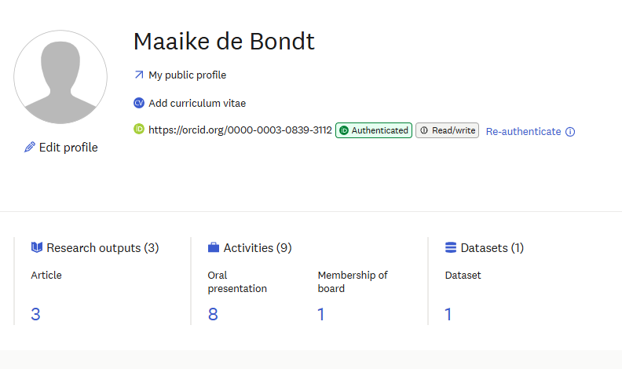

[](https://doi.org/10.5281/zenodo.24104159)

STEP 3: using Git and GitHub helped me already throughout this exercise. I try to commit and push things in Positron, but I also need to pull things sometimes, as I for example changed the license file on GitHub itself. Using version control is very important for many things, but for me personally it's most important in collaboration and as a time machine. I do not need to worry about breaking my script, as I can simply go back whenever I need to. By writing meaningful commit messages, it can also help me explain my own thoughts to a later version of myself.

STEP 5 and 6: I had performed these steps already during the course. Therefore, an older version of the project is archived in the currently shown DOI. The different commits are visible in the beginning of this project. 

STEP 7: My Pure account is set to private, therefore I added a screenshot of my account. I know how to upload software/datasets in Pure now. However, I will not add the currently created DOI, as it is not a real project and more a text exercise. I did add a dataset of previous research (which I already had uploaded to Zenodo). 

# Software Management Plan (short answers)
1. Purpose: My software is created to perform data analysis of a large (+-30,000 cases) dataset. The tasks include: data cleaning, data preparation, data visualization, and statistical analysis. 
Intended user community: As the dataset comes from the LROI (Dutch Arthroplasty Register), I expect that other researchers doing analysis using data from the LROI may benefit from reading/using this software. 
2. Git and GitHub will be used to manage the source code. 
3. The software will be made publicly available by sharing a release on Zenodo once the analysis has been performed. 
4. License: CC-BY-4.0. Others may use my software, but need to cite me, according to the CITATION.cff file. 
5. All dependencies of the code will be saved in the renv.lock file and shared in the repository. Additionally, suitable inline code comments will be given to increase reproducibility. 
Long-term sustainability will be supported by the use of Git-based version control, comprehensive documentation, coding standards, documented dependencies, and regular software releases. Development will take place in a public repository, and stable versions will be archived to promote reproducibility, reuse, and future maintenance.
6. No active development is planned after my PhD has been completed, although users will be able to access the software and documentation through the project repository. Bug reports and user feedback can be submitted via the repository issue tracker. While no dedicated funding is available for long-term development, critical bug fixes and documentation updates will be implemented when feasible.
7. Required resources include repository hosting, documentation, and limited maintenance for bug fixes. These resources will be provided by the project team and host institution. Future development will depend on the availability of follow-up funding and community interest.
8. Comprehensive documentation, including installation instructions, dependencies, and example workflows, will be provided. Stable releases will be archived with a DOI through a repository such as Zenodo. The software will follow open file formats to maximize future compatibility and reusability. 
9. The software will be documented by extensive README files and inline code comments, where appropriate. 
10. All installation requirements and dependencies of the code will be saved in the renv.lock file and shared in the repository.
11. Citation is managed through the CITATION.cff file. Furthermore, the corresponding DOI is provided on the top of this README file. 
12. Software will be tested by requesting a code check at the University of Twente. If somebody else is able to run my code and obtain similar results; this shows a proper test of the software. 
13. The software will be packaged as a version-controlled release and distributed through a public GitHub repository. Stable versions will be archived in Zenodo and assigned a DOI. Documentation, installation instructions, and example workflows will be distributed together with the software.


# R Research Software Template
<div align="center">
  
</div>

I followed the R Research Software Template to comply with the [University of Twente Research Software Guidelines](https://zenodo.org/records/15807424) for making my software project FAIR.
To align with FAIR4RS (Findable, Accessible, Interoperable, Reusable for Research Software) and Dutch Open Science standards (supported by institutions like NWO and eScience Center), my R project is treated as a research software package. 

## Folder Structure
I adopted the recommended structure for an R research software at UT to the currently available documents, or the types of documents I intend to use in the (near) future:

```text
RSM/
├── data/
│   ├── raw/                # Read-only original data
│   └── processed/          # Data generated by scripts (don't track in Git)
├── code/                   # R functions and logic (modular code, Analysis execution, ordered 01_., 02_.)
├── img/                    # Image files (.png, .jgeg, .svg.,.tiff)
├── outputs/
│   ├── figures/            # Generated plots used in journal article
│   └── reports/            # Final publication will be stored in this folder
├── tests/                  # N/A. My programming skills do not allow building tests for my R function
├── docs/                   # Documentation (e.g., Quarto website)
├── .github/                # GitHub Actions for CI/CD and FAIR automation
├── CITATION.cff            # Machine-readable citation metadata
├── codemeta.json           # FAIR: Comprehensive software metadata
├── DESCRIPTION             # R-standard metadata (dependencies)
├── LICENSE                 # Open Science: e.g., MIT or Apache 2.0
├── README.md               # Human-readable entry point
└── renv.lock               # Reproducibility: R environment snapshot
```

## Installation
**Requirements** 
- [R version 4.3.0 or later](https://cran.r-project.org/bin/windows/base/) 
- R packages:
    [palmerpenguins](https://allisonhorst.github.io/palmerpenguins/),
    [ggplot2](https://ggplot2.tidyverse.org/),
    [dplyr](https://cran.r-project.org/web/packages/dplyr/index.html)
  
The script has been developed and tested on Windows 11 but is expected to run on any operating system supported by R (Windows, macOS, or Linux).

## License
This software is distributed under a [CC-BY-4.0](LICENSE). 

## Copyright
deBondt&copy; , The Netherlands. 

## Citation
The citation file can be found [here](https://github.com/mrdb198/RSM/blob/main/CITATION.cff). 

## Acknowlegdements

- [Best practices for sustainable software project, TDCC NES](https://github.com/SS-NES)
- This repository could not have been created without the astonishing help of the Research Software Management course. Thank you, Nestor and team!
